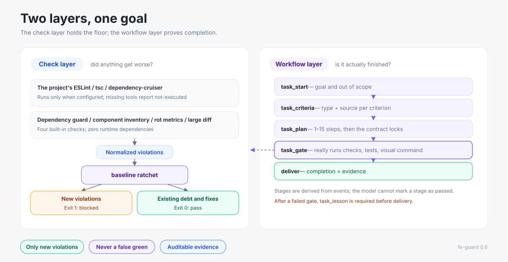

# fe-guard

> Turn frontend conventions into a single pass/fail command, and turn AI-driven repository rot into an enforceable gate.

[](https://github.com/luffy-lcc/fe-guard/actions/workflows/ci.yml)
[](https://github.com/luffy-lcc/fe-guard/releases)
[](./LICENSE)
[](https://nodejs.org)

**English** · [简体中文](./README.zh-CN.md)

fe-guard orchestrates the ESLint, tsc and dependency-cruiser you already have, normalizes their output into one violation shape, and uses a **baseline ratchet** to freeze legacy debt — **only new violations can fail the gate**. On top of that, it turns the AI development workflow into **MCP tools**: the AI in Trae / Cursor must call tools to advance through "contract → acceptance criteria → plan → implement → verify → deliver". Stage decisions live in code, not in the model's self-reporting.

## 60-second overview

- **Turn your existing lint / tsc / dependency-cruiser into a gate that only blocks new violations.** Legacy debt is frozen in a baseline ledger; fixing it tightens the ledger automatically.
- **Turn the AI's "done" into checkable gate evidence.** MCP tools advance contract → criteria → plan → implement → verify → deliver; the AI cannot mark a stage as passed.
- **Never a false green.** A check that did not run is `not-executed` and can never enter the baseline; skipped is not passed.



*The check layer answers "did anything get worse?"; the workflow layer answers "is it actually finished?".*

| Problem | What fe-guard does |
| --- | --- |
| Full lint goes red, so the check gets disabled | freeze existing debt, block only new violations |
| The AI claims completion with no proof | MCP workflow + gate evidence + completion |
| Duplicate components, dependency sprawl, file rot | four built-in checks + on-demand component lookup |

Not a good fit for one-line copy changes, teams that do not want a committed baseline ledger, or anyone expecting autofix / semantic architecture review. Prefer the full visual walkthrough? See [why fe-guard](docs/promotion.md).

## Why

- **AI output outpaces human review**: rebuilt components, a second library for the same capability, bloated files, `any` everywhere, copy-paste — human review can't keep up.
- **Conventions in docs rely on memory**: turn on full lint and hundreds of legacy issues make the team disable the check entirely.
- **"Done" is unverifiable**: the AI claims completion with no auditable evidence.

fe-guard does one thing: make "**no worse than before**" automatic. Legacy debt is frozen, not demanded to be paid off at once; new violations must fail; fixing old debt auto-tightens the baseline, never loosens it.

## Features

- **Zero runtime dependencies**, Node 18+, ESM — the install is just a few source files.
- **Seven checks**: ESLint / TypeScript / architecture boundaries (orchestrating external tools) + dependency guard / component inventory / rot metrics / large-diff (built-in, lightweight).
- **Dual-track baseline ratchet**: counts + metric maxima, only tightens, auditable via `firstSeen` / `widenLog`.
- **monorepo per-package ledgers**: optional `baseline.strategy: "package"` gives each workspace package its own ledger (with `--migrate-packages` for existing repos); root mode stays the default.
- **MCP workflow layer**: event-sourced, stages derived from events, the AI cannot self-report "passed"; criteria can bind a test that the gate really runs.
- **Structured contract with human gates**: every criterion needs `type` (ui / interaction / data / tracking / compat / performance) + `source`; `assumption` items must be confirmed by a human (`task confirm`), and a human can turn criteria into `deferred` release todos (`task defer`) — delivery is then marked `degraded` and reported as "N done / M deferred", never "all done".
- **Evidence instead of claims**: every gate writes a snapshot to `.fe-guard/evidence/<taskId>/<evidenceId>.json`; `verify: manual` evidence is hashed (bytes + sha256); `completion` exposes `achieved / total / remaining / deferred`.
- **Preflight, rework and retrospectives**: `workflow.preflight` supports single or multi-step checks, refuses to start a task when the environment is broken, and never lets a gate pass without executing; gate fingerprints return `fixed` / `introduced`; `task_lesson` + `workflow.distill` require a lesson after a failed gate.
- **Visual evidence without a built-in browser**: criteria can declare `evidenceKind` (`screenshot` / `diff` / `log`); `workflow.visualDiff.command` runs the project's own visual comparison and records its output, exit code and hash. A missing or failed command never covers the criterion.
- **Effect stats**: read-only `fe-guard task stats [--json]` aggregates delivery / degraded, gate failure rate, average gates per task, top blockers, lessons and deferred criteria.
- **fast / full profiles**: hooks under 3 seconds, full profile manually before merge.
- **Honest engineering**: a check that didn't run reports `not-executed` (non-baselineable); skipped ≠ passed; never a false green.
- **Shareable output**: `check --format sarif` feeds GitHub Code Scanning (new violations + `not-executed` only, so legacy debt doesn't flood the alerts page); `check --format html` writes a single self-contained report with zero external assets.
- **One config controls everything**: disable or downgrade by editing config; `workflow.enabled: false` falls back to pure checks.

## Quick start

```bash
npm i -D fe-guard          # before npm publish: npm i -D github:luffy-lcc/fe-guard
npx fe-guard init          # probe the project, then write config / ledger / AGENTS.md / IDE artifacts
npx fe-guard baseline      # record existing violations once (check turns green)
npx fe-guard check         # blocks only new violations; fixing old ones auto-tightens
npx fe-guard task stats    # after AI-driven tasks: read-only delivery / gate / lesson stats
# .husky/pre-commit:
npx fe-guard check --staged --profile fast
```

Close the loop: add `const unused = 1` → `check` fails → remove it → passes.

Adopting into a legacy codebase? `npx fe-guard init --preset legacy --dry-run` previews a looser starting config (thresholds and files) without writing anything; drop `--dry-run` to apply it. Presets: `js`, `vue`, `legacy`, `monorepo` — see [Getting started → Presets](docs/getting-started.md#presets-and---dry-run).

## Use in AI IDEs (MCP)

`npx fe-guard init` wires the workflow layer into five project-level MCP configs — Trae (`.trae/mcp.json`), Cursor (`.cursor/mcp.json`), Claude Code (`.mcp.json`), VS Code (`.vscode/mcp.json`, `servers` + `"type": "stdio"`) and Gemini CLI (`.gemini/settings.json`). In each file it only manages its own `fe-guard` entry: other servers and other settings keys are preserved, and your home directory is never touched. Any other MCP client can mount the stdio server manually:

```json
{ "mcpServers": { "fe-guard": { "command": "node", "args": ["./node_modules/fe-guard/bin/fe-guard-mcp.js"] } } }
```

The AI gets 7 `task_*` tools + `ui_lookup` and must call them to advance through contract → criteria → plan → implement → verify → deliver. Stage decisions live in code, so it cannot self-report "passed". On macOS, GUI apps don't load the shell PATH — with nvm/fnm, use absolute paths for `command`/`args` ([FAQ](docs/faq.md)).

No extra Skill is required: `init` already writes resident rules, slash commands and MCP configs. A Skill is an optional guidance layer; decisions stay in the MCP tools and exit codes ([details](docs/workflow.md)).

Full walkthrough: [workflow](docs/workflow.md).

## Documentation

| Topic | Link |
| --- | --- |
| Positioning, diagrams and the full story | [promotion](docs/promotion.md) |
| Quick start / commands / doctor / intranet distribution | [getting-started](docs/getting-started.md) |
| The seven checks and how they detect | [checks](docs/checks.md) |
| Baseline ratchet / profiles / exit codes | [baseline](docs/baseline.md) |
| AI IDE / MCP workflow layer | [workflow](docs/workflow.md) |
| Configuration reference / monorepo / Vue | [configuration](docs/configuration.md) |
| Progressive adoption and common concerns | [adoption](docs/adoption.md) |
| FAQ and troubleshooting | [faq](docs/faq.md) |
| Known limitations and non-goals | [limitations](docs/limitations.md) |
| Design trade-offs and architecture | [design](docs/design.md) |
| Roadmap | [roadmap](docs/roadmap.md) |
| Real-world measurement report | [real-world](docs/real-world.md) |

Chinese documentation: [README.zh-CN.md](./README.zh-CN.md) · [docs/zh/](docs/zh/).

## Real-world evidence

Measured on copies of 3 real Vue repositories (100k–180k lines):

- 100k-line single repo: fast profile **2.0s**, full **2.5s** — the 3-second hook target holds.
- Legacy debt recorded once (956 / 11424 entries), then `check` exits 0; **error-level false positives: 0 / 1092**.
- boundaries (depcruise 18.8.0): 19 real circular dependencies, **0 false positives** in sampling, check < 1s.
- Caught real shared-component rebuilds, near-identical duplicate modules, and `.vue` type errors.

Full numbers and per-item judgments: [real-world report](docs/real-world.md).

## Requirements

- Node 18+, project is a git repository.
- The orchestrated tools (ESLint / TypeScript / dependency-cruiser) are installed by the project itself; fe-guard has zero runtime dependencies. Missing tools yield an explicit "not executed" or can be disabled.

## Contributing & license

Contributions welcome — read [CONTRIBUTING](./CONTRIBUTING.md) first (zero deps, no premature abstraction, real verification required). See [CODE_OF_CONDUCT](./CODE_OF_CONDUCT.md).

[MIT](./LICENSE) © fe-guard contributors
