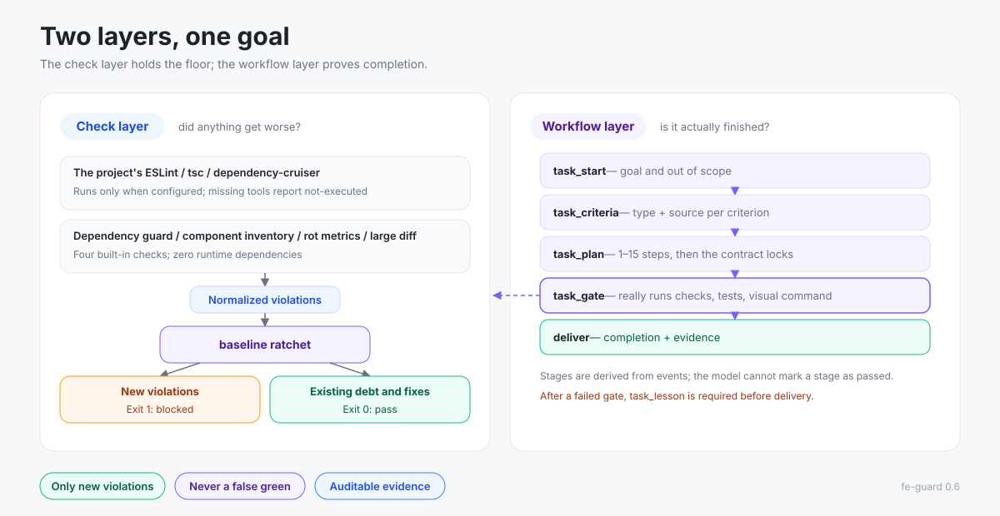
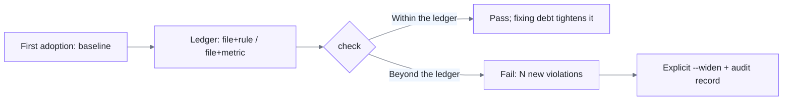
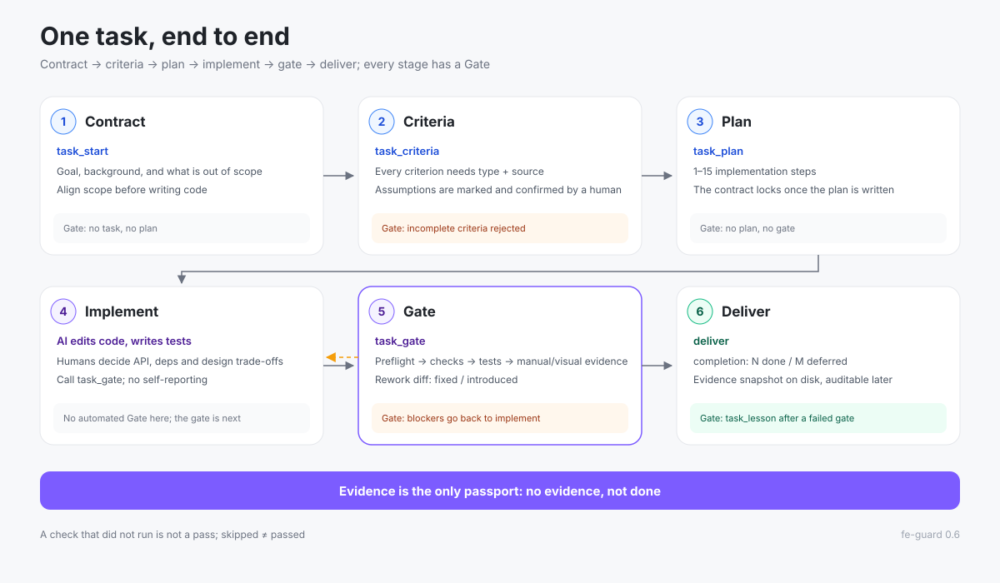
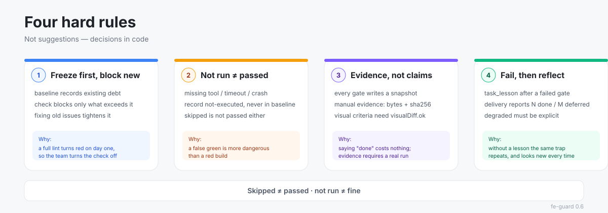
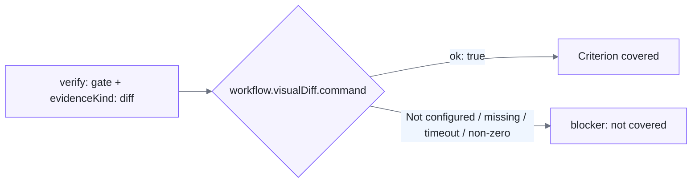
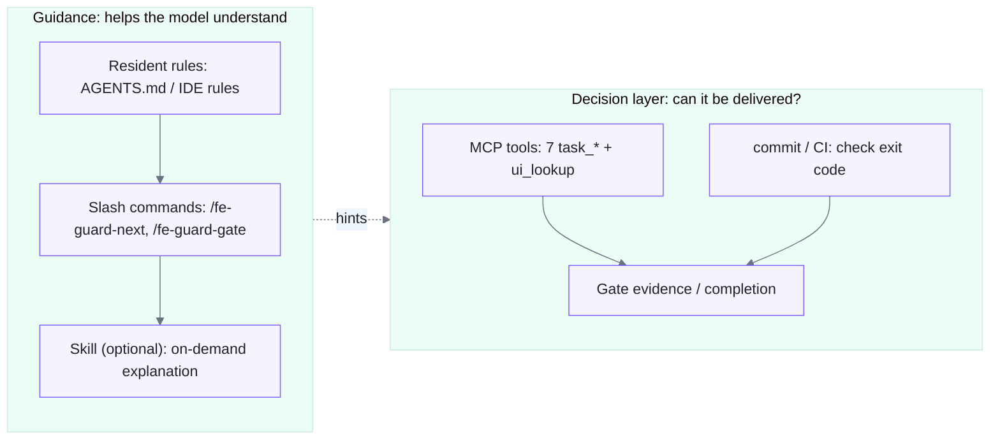
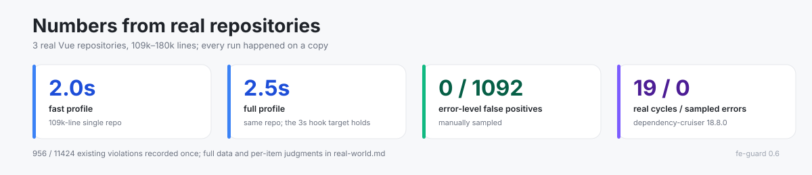

# Start from "No Worse": fe-guard's Frontend Quality Gate and AI Workflow

> Freeze legacy debt with a baseline ratchet, and turn the AI's "done" into checkable gate evidence.

**Contents**

- [01 · Start with the conclusion](#01--start-with-the-conclusion)
- [02 · A familiar afternoon](#02--a-familiar-afternoon)
- [03 · Why full lint cannot save you](#03--why-full-lint-cannot-save-you)
- [04 · Two layers: checks and workflow](#04--two-layers-checks-and-workflow)
- [05 · baseline: freeze first, block only new](#05--baseline-freeze-first-block-only-new)
- [06 · Workflow: turn "done" into evidence](#06--workflow-turn-done-into-evidence)
- [07 · 0.6: visual evidence only trusts the project's command](#07--06-visual-evidence-only-trusts-the-projects-command)
- [08 · Skills, rules and MCP](#08--skills-rules-and-mcp)
- [09 · Numbers from real repositories](#09--numbers-from-real-repositories)
- [10 · Who it is for](#10--who-it-is-for)
- [11 · Five-minute setup](#11--five-minute-setup)
- [12 · Final thought](#12--final-thought)

---

## 01 · Start with the conclusion

fe-guard does one thing: make "no worse than before" automatic.

- **Turn your existing lint / tsc / dependency-cruiser into a gate that only blocks new violations.** Legacy debt is frozen in a baseline ledger; fixing it tightens the ledger automatically.
- **Turn the AI's "done" into checkable gate evidence.** MCP tools advance contract → criteria → plan → implement → verify → deliver; the AI cannot mark a stage as passed.
- **Never a false green.** A check that did not run is `not-executed` and can never enter the baseline; skipped is not passed.



*Figure 1: the check layer answers "did anything get worse?"; the workflow layer answers "is it actually finished?"*

| What it does | What it does not do |
| --- | --- |
| Orchestrates the project's existing ESLint / tsc / dependency-cruiser | Does not replace ESLint / tsc or reimplement checkers |
| baseline freezes existing debt and blocks only new violations | Does not autofix or refactor for you |
| Keeps a per-package ledger in monorepos | Does not make semantic "should this component be reused" judgments |
| MCP workflow + gate evidence + completion report | Does not bundle a browser or implement pixel diff |
| JSON / SARIF / single-file HTML reports | Does not provide a cross-repo task queue or distributed execution |

---

## 02 · A familiar afternoon

At 10 a.m., you drop a requirement and a design link into the AI:

> "Implement it and tell me when it's done."

Three minutes later:

> "All features are complete, implemented, and verified."

The tone is confident, the formatting is nice. You open the page:

- The button should only appear on hover, but it is always visible;
- There is an extra gap between the modal title and its options;
- The mobile long-press menu is missing;
- After a refresh, whatever was just inserted is gone.

You start writing bug descriptions. It says "You're right, I'll fix it." You check again and find new problems. By 6 p.m., you have written twenty bug reports and zero lines of code.

The problem is not that the AI cannot write code. The problem is that saying "done" costs nothing. fe-guard does not try to make the model smarter; it makes "done" require evidence.

---

## 03 · Why full lint cannot save you

Most frontend repositories are not ruined by one big rewrite. They are worn down by a chain of commits that each looks "fine".

A feature adds another dropdown that differs from an existing component by two props; a deadline introduces a second date library; a page grows from 300 to 800 lines; `any` goes from 3 to 30. Each diff is reviewable — it did solve the problem at hand. Three months later, duplicate components, two time-handling stacks and a file nobody dares to touch are all there, and the team starts talking about "cleanup".

The traditional answer is a full lint: the first run shows hundreds or thousands of issues, review says "turn it off for now, we'll clean it later". The check stops being a gate and becomes a report nobody reads. AI makes generation faster, so this arrives sooner — the faster the code is written, the more a path that automatically protects the floor is needed.

### Not another lint wrapper

fe-guard does not reimplement ESLint or ask a team to replace its tools. It orchestrates and normalizes: different tool outputs become one violation shape, then three things the tools do not provide are added:

- **Legacy ratchet**: block only what is new, keep history auditable;
- **Unified execution**: per-package monorepos, automatic `vue-tsc` for Vue, subdirectory roots, fast / full profiles;
- **Report outputs**: JSON / SARIF / single-file HTML for CI and code scanning.

### Seven checks: hand deterministic problems to tools

| Check | What it blocks |
| --- | --- |
| ESLint / TypeScript / boundaries | Syntax, types, cycles and forbidden layer crossings |
| Dependency guard | Unregistered new dependencies, phantom packages, two libraries for the same capability |
| Component inventory | Duplicate names and components with heavily overlapping props |
| Rot metrics | File length, long functions, explicit `any`, cross-file duplicate blocks |
| Large diff | Too many files/lines in one change; split the PR |

The baseline keeps two ledgers: `(file, rule) -> allowed count` and `(file, metric) -> allowed maximum`. It only tightens, never loosens, with auditable `firstSeen` / `widenLog`. Monorepos can keep one ledger per package, so paying down package A never tightens package B by accident.

### Monorepos, Vue and React

- **Monorepos**: detects `package.json` workspaces, `pnpm-workspace.yaml` and `lerna.json`; ESLint / TypeScript run per package with each package's own config, in parallel; since 0.5 the baseline can also be kept per package.
- **Vue**: switches to `vue-tsc` automatically when `.vue` files exist; if `.vue` exists but `vue-tsc` is unavailable, it fails clearly instead of silently skipping.
- **React / TSX**: verified on real open-source repositories; stories and test files are no longer treated as components.
- **Subdirectory projects**: when backend and frontend share a repo, mount with `--root frontend` and git-related paths stay correct.

Zero runtime dependencies, Node 18+, installation size is just the source files.

---

## 04 · Two layers: checks and workflow

fe-guard does not assume a project can pay down all legacy debt at once. It splits quality into two layers: the **check layer** answers "did anything get worse?", the **workflow layer** answers "is it actually finished?". Use both, or just the check layer.

These tasks used to depend on people:

| Before, humans did | Now fe-guard takes over | What humans still do |
| --- | --- | --- |
| Read the requirement and find gaps | Every criterion needs `type` + `source`; assumptions are marked | Confirm assumptions (`task confirm`) |
| Open the page and check each state | The gate really runs ESLint / tsc / tests / the visual command and stores evidence | Provide the visual command, judge product trade-offs |
| Tell the AI what to fix | Blockers point to new violations, uncovered criteria and unconfirmed assumptions | Decide on `--widen` / `task defer` |
| Judge whether it is actually done | `completion` + evidence; reports "N done / M deferred" | Make the final release decision |
| Remind the AI not to repeat a mistake | baseline ratchet prevents regressions + `task_lesson` | Write the lesson, confirm the takeaway |

This is not "let the AI say it is done"; it turns "done" into facts that can be checked.

---

## 05 · baseline: freeze first, block only new

The first rule of the check layer is the baseline ratchet:

- Run `baseline` once on adoption to record existing violations;
- Every later `check` fails only on what goes beyond the ledger;
- Fixing legacy debt tightens the ledger automatically; widening requires an explicit `--widen` with an audit record;
- A monorepo can keep one ledger per package, so paying down A never tightens B.



This is the opposite of "everything must be clean": **it accepts history, but does not let history keep growing.** A project may not become healthy through one cleanup, but it can improve by never getting worse on any commit.

If a ledger is deleted by mistake, `baseline --verify` fails instead of silently unfreezing debt.

---

## 06 · Workflow: turn "done" into evidence

The check layer answers "did anything get worse?". The workflow layer answers "is this actually finished?". fe-guard exposes the process as MCP tools:

**contract → criteria → plan → implement → gate → deliver**



*Figure 2: six cards for six stages; every stage has a Gate, and blockers send the task back to implement.*

| Stage | Tool | Output |
| --- | --- | --- |
| Contract | `task_start` | Goal, background, and what is out of scope |
| Criteria | `task_criteria` | `type` + `source`; optional `testFile` / `evidenceFile` |
| Plan | `task_plan` | 1–15 steps; the contract locks afterwards |
| Implement | — | Code, tests, required evidence files |
| Gate | `task_gate` | Checks, tests, manual/visual evidence, rework diff |
| Deliver | Derived from events | `completion` + evidence snapshot |

The model cannot mark a stage as passed, and there is no "I'm done" tool. Every action is appended to an event stream, and the stage is derived from events:

- **Every criterion** must state `type` (UI / interaction / data / tracking / compat / performance) and `source` (requirement, design, code, or `assumption`);
- Criteria that can be tested bind a `testFile`, which the gate really runs; manual/visual checks bind an `evidenceFile`, recorded with `bytes` and `sha256`;
- Assumptions require a human `task confirm`; a condition the team explicitly drops requires a human `task defer`, and delivery is marked `degraded` with the remaining todos listed;
- Every gate writes a snapshot under `.fe-guard/evidence/...` and reports how many issues were fixed and how many were introduced;
- After a failed gate, delivery requires a `task_lesson`; `workflow.distill` defaults to `enforce`;
- `task stats` aggregates delivery rate, gate failure rate, top blockers, lessons and deferred items, read-only.

These are decisions in code, not prompt suggestions. The model may say "done", but only gate evidence can move the task into delivery.

### Four hard rules



*Figure 3: every rule comes with a one-line "why"; it is not ceremony.*

- **Freeze first, block only new**: baseline records existing debt; `check` blocks only what exceeds the ledger.
- **Not run ≠ passed**: missing tools, timeouts and crashes become `not-executed` and never enter the baseline.
- **Evidence, not claims**: gate snapshots, manual evidence sha256, and `visualDiff.ok` for visual criteria.
- **Fail, then reflect**: `task_lesson`; delivery reports "N done / M deferred".

### Honest engineering: no false green

- Missing tool, timeout or crash → `<check>/not-executed`, which can never enter the baseline;
- A package with no ESLint config → recorded as `skipped`, not passed;
- depcruise parsing only some `.vue` files → "dependency graph incomplete", never a fake zero;
- Environment preflight fails → the check did not execute and cannot cover criteria; with multi-step preflight, the error names the failed step;
- A deleted package ledger → `baseline --verify` fails instead of silently unfreezing debt.

Skipped is not passed. Not executed is not fine. That is the difference between this and "run lint and call it a quality gate".

---

## 07 · 0.6: visual evidence only trusts the project's command

0.6.0 turns "screenshot / diff" from a slogan into optional gate evidence without embedding a browser:

- Criteria can declare `evidenceKind`: `screenshot` / `diff` / `log`; manual infers it from the extension, and `verify: gate` only accepts `diff`.
- With `workflow.visualDiff.command`, a gate runs the project's own command once whenever the task has visual criteria; all visual criteria share that result.
- stdout / stderr are written to `.fe-guard/evidence/<taskId>/<evidenceId>-visual.log`, with exit code, bytes and sha256.
- Only `visualDiff.ok === true` covers the criterion; not configured, missing, timeout and non-zero exit never do — even in `warn` mode.
- No browser is started and no dependency is installed; Playwright / Chromatic / custom scripts are provided by the project.



```json
{ "workflow": { "visualDiff": { "command": "npm run visual:diff", "timeoutMs": 120000 } } }
```

Preflight also supports multiple steps: `workflow.preflight.steps[]` takes 1–10 named checks, runs them in order and stops at the first failure, naming the failed step. It is mutually exclusive with the single `command`. See [workflow](workflow.md) and [configuration](configuration.md).

An agent screenshot can be `verify: manual` + `evidenceKind: "screenshot"` evidence, but it cannot replace `verify: gate` + `diff`; the latter must come from `visualDiff.command`.

---

## 08 · Skills, rules and MCP

fe-guard does not require any Skill. `init` generates resident rules, slash commands and MCP configs; a Skill is an optional manual, not a decision layer.



| Layer | Artifact / location | Job | Can it replace the gate? |
| --- | --- | --- | --- |
| Resident rules | the managed `AGENTS.md` snippet; `.trae/rules/fe-guard.md`; `.cursor/rules/fe-guard.mdc` | tell the model which tools to use, with minimal tokens | No; the model can ignore it |
| Slash commands | `.trae/commands/fe-guard-next.md`, `fe-guard-gate.md` | manually trigger the next step / gate | No; just an entry point |
| Skill (optional) | project or global skill; not bundled today | on-demand explanations, diagnostics, batch operations | No; guidance only |
| MCP tools | 7 `task_*` tools + `ui_lookup` | advance stages, run checks, write evidence | Hard decisions inside the workflow |
| commit / CI | `check --staged --profile fast`, `check --full` | the outer backstop | The only unbypassable path (except `--no-verify`) |

Why decisions are not put in a Skill:

- **Tokens**: resident rules cost tokens; the AGENTS.md snippet is ~591 / 600. A skill loads on demand but is still guidance.
- **Verifiability**: stages and criterion coverage are derived from events and evidence; no skill text can make `task_gate` pass.
- **Single source of truth**: generated artifacts come from `src/ide/source.js`; a second rule set in a skill would be a second workflow to maintain.
- **Good uses of a skill**: long-tail diagnostics (doctor, FAQ walkthroughs, batch operations), not the core gate.

> **One line**: no Skill install is required. MCP is the hard path; a Skill is optional guidance.

---

## 09 · Numbers from real repositories



*Figure 4: measured on copies of 3 real Vue repositories.*

- A 109k-line single repo: `--profile fast` **2.0s**, full profile **2.5s** — the 3-second hook target holds;
- First adoption recorded 956 / 11424 violations, after which `check` exits 0 and only new violations are shown by default;
- Error-level false positives: **0 / 1092**;
- boundaries (depcruise 18.8.0) found **19 real cycles**, with 3 manually traced samples and **0 false positives**, under 1s.

React / TSX was also run against two open-source repositories and uncovered real issues: Storybook stories treated as components, subdirectory projects reading the git-root `package.json`, a fully ignored ESLint package aborting the gate, and `"."` in `pnpm-workspace.yaml` running the root package twice.

These numbers do not mean fe-guard can replace architecture review. They mean: **deterministic problems can be handed to deterministic tools.** Full data and per-item judgments: [real-world report](real-world.md).

---

## 10 · Who it is for

| Good fit | Not a good fit |
| --- | --- |
| Frontend repos with legacy debt that do not want to turn all checks off after the first full lint | One-line copy changes that need no process |
| Teams with multiple people/packages and AI-assisted development, where human review no longer catches duplicate components, dependency sprawl and file rot | Anyone expecting semantic architecture review, automatic refactoring or autofix |
| Teams that want the AI's "done" to come with evidence instead of clicking through pages | Teams that do not want a committed baseline ledger — the ledger needs an owner |

### Four common misconceptions

**Is this just another lint wrapper?**
No. Lint answers "is this line wrong?"; fe-guard also answers "is this commit worse than the ledger?" and "is the AI's 'done' backed by evidence?".

**Is the baseline a permanent exemption?**
No. The ledger only tightens: fixing old issues tightens it automatically; widening requires an explicit `--widen` with an audit record; deleting a package ledger is caught by `--verify`.

**Can an AI screenshot replace visual evidence?**
No. A screenshot can be `verify: manual` evidence; a `verify: gate` + `diff` criterion must be produced by the project's own `visualDiff.command`.

**Do I have to use MCP?**
No. `check` / `baseline` work standalone; the MCP workflow layer is for AI-assisted development where delivery needs to be checkable.

---

## 11 · Five-minute setup

```bash
npm i -D github:luffy-lcc/fe-guard#v0.6.0   # or the tarball from Releases
npx fe-guard init      # probe the project, write config / ledger / AGENTS.md / MCP configs
npx fe-guard baseline  # record existing debt once
npx fe-guard check     # block only new violations
```

After the first `baseline`, `check` should exit 0; later runs show only new violations. One command for hooks and one before merge:

```bash
npx fe-guard check --staged --profile fast   # pre-commit, under 3 seconds
npx fe-guard check --full                    # before merge, full profile
```

Reports can be JSON, SARIF or a single-file HTML:

```bash
npx fe-guard check --full --format sarif > fe-guard.sarif
npx fe-guard check --full --format html
```

More commands, `doctor`, intranet distribution and troubleshooting: [getting started](getting-started.md).

---

## 12 · Final thought

AI writing speed is no longer the bottleneck; the bottleneck is who verifies the work afterwards. fe-guard's answer is simple:

> Trust the evidence, not the claim; never let a project get worse because someone said "done".

If this resonates, start with one repository, one `baseline`, and one pre-commit hook. It will not make the project clean overnight, but it will make the next commit no worse than the last.
