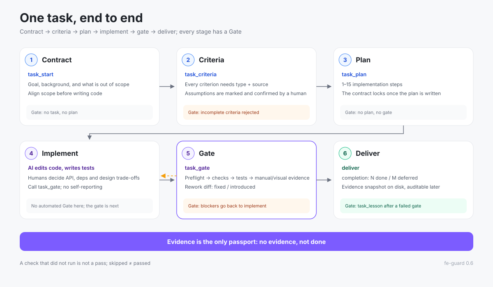
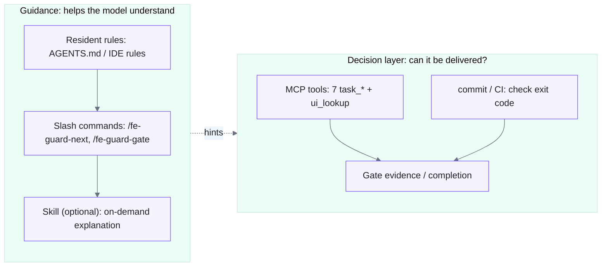
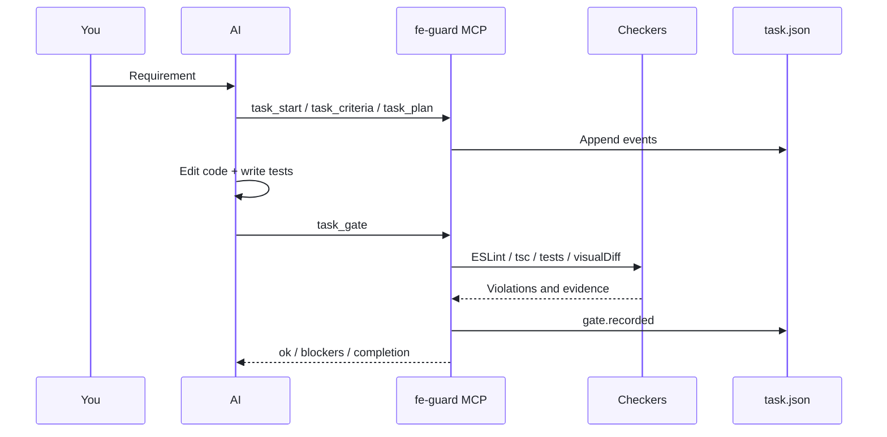
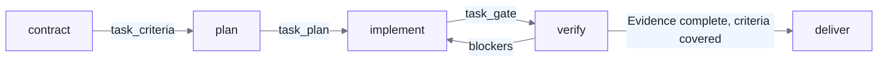

# Conversation-driven development in AI IDEs

[← Back to README](../README.md) · [简体中文](zh/workflow.md)

## Why not one big prompt

Writing the AI a rule like "write requirements first, then a plan, then run the checks" is basically unreliable: rule files as a whole do not improve success rates and add roughly 20% inference cost. Only one kind actually works — **non-standard conventions the model cannot guess from common sense**.

So the workflow layer does this:

- The workflow is made of **tools** (an MCP server). The AI must call tools to advance; stages are derived from the events the tools write.
- Hard rules live in **code**. There is no "mark the stage as passed" tool; nothing the model outputs can move a task into the delivered state.
- The generated rule file keeps only the shortest set of non-standard conventions (the AGENTS.md snippet is ~591 tokens, capped at 600).



*Figure: contract → criteria → plan → implement → gate → deliver; every stage has a Gate.*

## Skills, rules and MCP: who does what

fe-guard does not require any Skill. `init` generates resident rules, slash commands and MCP configs; a Skill is an optional manual, not a decision layer.



| Layer | `init` artifact / location | Job | Can it replace the gate? |
| --- | --- | --- | --- |
| Resident rules | the managed `AGENTS.md` snippet; `.trae/rules/fe-guard.md`; `.cursor/rules/fe-guard.mdc` | tell the model which tools to use, with minimal tokens | No; the model can ignore it |
| Slash commands | `.trae/commands/fe-guard-next.md`, `fe-guard-gate.md` | manually trigger the next step / gate | No; just an entry point |
| Skill (optional) | project or global skill; not bundled today | on-demand explanations, diagnostics, batch operations | No; guidance only |
| MCP tools | 7 `task_*` tools + `ui_lookup`, 8 total | advance stages, run checks, write evidence | Hard decisions inside the workflow |
| commit / CI | `check --staged --profile fast`, `check --full` | the outer backstop | The only unbypassable path (except `--no-verify`) |

Why decisions are not put in a Skill:

- **Tokens**: resident rules cost tokens; the AGENTS.md snippet is ~591 / 600. A skill loads on demand but is still guidance.
- **Verifiability**: stages and criterion coverage are derived from events and evidence; no skill text can make `task_gate` pass.
- **Single source of truth**: generated artifacts come from `src/ide/source.js`; a second rule set in a skill would be a second workflow to maintain.
- **Good uses of a skill**: long-tail diagnostics (doctor, FAQ walkthroughs, batch operations), not the core gate.

## Connecting Trae

1. Run `npx fe-guard init` in the project (it writes `.trae/mcp.json`).
2. Open Trae's MCP panel, confirm `fe-guard` appears, and you should see 7 `task_*` tools and 1 `ui_lookup`.
3. `.trae/rules/fe-guard.md` is read as a project rule; `.trae/commands/` gains two slash commands, `/fe-guard-next` and `/fe-guard-gate`.

The generated config looks roughly like:

```json
{
  "mcpServers": {
    "fe-guard": {
      "command": "node",
      "args": ["./node_modules/fe-guard/bin/fe-guard-mcp.js"]
    }
  }
}
```

If fe-guard is not installed locally in the project (e.g. you use this repo's CLI directly), this is written as the absolute path of the current installation; after switching machines, just rerun `init`.

> macOS GUI apps do not load the shell's PATH: when node is installed under nvm / fnm, `command: "node"` may ENOENT — red error in the panel, 0 tools. Change both `command` and `args` to absolute paths. See the [FAQ](faq.md).

## Connecting Cursor

1. `npx fe-guard init` writes `.cursor/mcp.json`; confirm `fe-guard` is enabled under Settings → MCP.
2. `.cursor/rules/fe-guard.mdc` is set to `alwaysApply: true`, so Cursor reads it automatically.

## Connecting Claude Code / VS Code / Gemini CLI

`init` also writes these project-level configs, merging only its own `fe-guard` entry:

| Client | File | Shape |
| --- | --- | --- |
| Claude Code | `.mcp.json` | `mcpServers.fe-guard` |
| VS Code (Copilot agent) | `.vscode/mcp.json` | `servers.fe-guard` with `"type": "stdio"` |
| Gemini CLI | `.gemini/settings.json` | `mcpServers.fe-guard`; the file's other settings are untouched |

Reload the client or reopen the project to pick up the server. Windsurf / Cline / Codex CLI are deliberately not written: they only accept user-level configuration, and fe-guard never touches your home directory.

All clients use the same server, the same `AGENTS.md`, and the same task state — switching tools needs no reconfiguration.

## What a conversation looks like after setup

You say: "Add a formatDuration utility to the project; 1 second should display as 1s."

The AI calls the following tools in order (every request and return value is visible in the IDE's tool panel):

| Step | Tool | Returns |
| --- | --- | --- |
| 1 | `task_start` | `{ ok, taskId, stage: "contract", next: "task_criteria" }` |
| 2 | `task_criteria` | `{ ids: ["C1","C2"], stage: "plan", types: { ui: 1, data: 1 } }` |
| 3 | `task_plan` | `{ stage: "implement", next: "task_gate" }` |
| 4 | Edit code | — |
| 5 | `task_gate` | Passed: `{ ok: true, stage: "deliver", completion: { achieved: 2, total: 2, remaining: [], deferred: [] } }` |

The full chain:



Criteria that can be written as tests can carry a `testFile` (repo-relative path, e.g. `{ text: "formatDuration(1000) returns 1s", type: "data", source: "requirement#duration", testFile: "test/duration.test.mjs" }`). The gate really runs that test, and **only a pass covers the criterion**; the test command comes from the config `workflow.gate.testCommand` (default `node --test`) — the model can only supply a path, never a command. Every criterion also needs `type` and `source`; the next sections explain the rest of the contract.

When the gate does not pass, step 5 returns:

```json
{
  "ok": false,
  "stage": "verify",
  "completion": { "achieved": 0, "total": 2, "remaining": [{ "id": "C1", "text": "..." }], "deferred": [] },
  "blockers": [
    "Gate not passed: 1 new violation (error 1)",
    "eslint/@typescript-eslint/no-explicit-any @ src/utils/math.ts:12",
    "Criterion not covered: C1"
  ],
  "next": "Fix the issues and call task_gate again"
}
```

The AI fixes things according to the blockers and calls `task_gate` again. The tool never returns the full log (avoiding stuffing tens of thousands of lines back into context); when it needs details it reads `.fe-guard/report.json` itself.

## Acceptance criteria: type, source, verification

Every criterion is structured; a plain `{ text }` is rejected:

| Field | Required | Meaning |
| --- | --- | --- |
| `type` | yes | `ui` / `interaction` / `data` / `tracking` / `compat` / `performance` |
| `source` | yes | Where it comes from: requirement, design, code or existing behaviour. If you cannot point to a source, write `assumption: <reason>` |
| `verify` | no | `gate` / `test` / `manual`. Missing → `test` if `testFile`, `manual` if `evidenceFile`, otherwise `gate` |
| `testFile` | no | Repo-relative test file; the gate really runs it and only a pass covers the criterion |
| `evidenceFile` | no | Repo-relative manual evidence (screenshot notes, reconciliation records); the gate checks it exists and is non-empty |
| `evidenceKind` | no | `screenshot` / `diff` / `log`; manual is inferred from the extension, gate only accepts `diff` (requires `workflow.visualDiff.command`) |

```json
{
  "criteria": [
    { "text": "empty state shows 0 items", "type": "ui", "source": "design/spec-v3#empty", "verify": "gate" },
    { "text": "formatDuration(1000) returns 1s", "type": "data", "source": "requirement#duration", "testFile": "test/duration.test.mjs" },
    { "text": "keyboard focus follows tab order", "type": "interaction", "source": "assumption: design draft does not cover keyboard", "verify": "manual", "evidenceFile": "docs/evidence/focus.md" }
  ]
}
```

`testFile` and `evidenceFile` are mutually exclusive, and `verify` must agree with them (test → testFile, manual → evidenceFile, gate → neither). If every criterion is `ui`, `task_criteria` returns a warning — not a block, but usually a sign that data, interaction, tracking, compat or performance criteria are missing.

## Human decisions: confirm and defer

Two decisions are deliberately CLI-only — there is no MCP tool for them, so the model cannot approve itself:

```bash
# Confirm an assumption criterion (must be recorded after the criterion was declared)
npx fe-guard task confirm C2 --note "asked the PM: empty state should hide the list" --yes

# Turn a criterion into an explicit release todo
npx fe-guard task defer C3 --reason "backend endpoint not integrated yet" --yes
```

- `confirm` only accepts criteria whose `source` starts with `assumption`; a confirmation recorded before the criterion was declared does not count.
- `defer` means "explicitly drop or ship later". Deferred criteria need no evidence, but delivery is marked `degraded` and the completion lists them separately.
- Neither command can mark a task as delivered; the stage is still derived from events.

With 3 criteria, 2 covered and 1 deferred, the response says "2 done / 1 deferred" — never "all done". `task status` and `task events --summary` use the same wording.

## Evidence: snapshots and manual files

Every gate writes `.fe-guard/evidence/<taskId>/<evidenceId>.json` with the mode, exit code, summary, completion, criteria tests, manual evidence, violation fingerprints and preflight result. `task_gate` returns `evidencePath`; `task_status` returns `lastEvidencePath` plus each evidence item's path. If the write fails, the gate result is unchanged but the path is `null`.

`verify: manual` criteria record `{ file, bytes, sha256, kind }` — a fingerprint of the file at gate time (the same hash can later verify it was not replaced). `kind` is `screenshot` / `diff` / `log`; when omitted it is inferred from the extension (images → screenshot, `.diff/.patch` → diff, otherwise log). That proves the file existed and was not swapped, but it does **not** prove the screenshot or note is semantically correct; visual judgement still needs a human or an external tool.

A `verify: gate` criterion with `evidenceKind: "diff"` is covered only by the visual comparison command: `visualDiff.ok === true` is required. A failed, missing or timed-out command never covers it, even when `workflow.stages.verify` is `warn`.

`completion` is `{ achieved, total, remaining, deferred }`. Report "N done / M remaining" (plus deferred); never claim everything is done while `remaining` or `deferred` is non-empty.

## Environment preflight

Single command (legacy form):

```json
{ "workflow": { "preflight": { "command": "npm run check:env", "timeoutMs": 60000 } } }
```

Multiple steps:

```json
{
  "workflow": {
    "preflight": {
      "timeoutMs": 60000,
      "steps": [
        { "name": "dev-server", "command": "curl -fsS http://127.0.0.1:5173", "timeoutMs": 5000 },
        { "name": "api-proxy", "command": "curl -fsS http://127.0.0.1:5173/api/health" }
      ]
    }
  }
}
```

`command` and `steps` are mutually exclusive; `steps` accepts 1–10 named checks with unique names, and each step can override `timeoutMs`. Steps run in order and stop at the first failure, which is reported by name. No `command` and no `steps` means preflight is off.

When configured:

- `task_start` runs it first. Failure returns `ok:false` with the failed step, command, exit code and output tail, and **no task is created**.
- `task_gate` runs it again. Failure appends `preflight.failed` and returns "environment preflight failed, this check was not executed": no evidence is written and criteria are not overwritten.

The command is split on whitespace (no shell interpretation), like `workflow.gate.testCommand`. fe-guard only runs the command the project provides — it does not know about your dev server, proxy or login state.

## Visual comparison: run the project's own command

```json
{ "workflow": { "visualDiff": { "command": "npm run visual:diff", "timeoutMs": 120000 } } }
```

- Runs only when at least one criterion has `verify: gate` + `evidenceKind: diff`; one run per gate covers all visual criteria.
- Does not run when the check itself failed, avoiding a pointless external command.
- stdout + stderr are written to `.fe-guard/evidence/<taskId>/<evidenceId>-visual.log`, with exit code, bytes and sha256.
- Non-zero exit, missing command, timeout or failed evidence write leaves the criterion uncovered and adds a blocker; it is never a pass.
- No browser is launched, no pixel diff is implemented, and no dependency is installed; Playwright / Chromatic / custom scripts all come from the project.
- With no visual criteria it does not run and records `ran: false, reason: "no-visual-criteria"`.

See [promotion](promotion.md) for the diagram and rationale.

## Rework diff: fixed vs introduced

Gate evidence stores violation fingerprints (rule + file + line, capped at 100). Each gate compares with the previous run and returns:

```json
{ "trend": { "previousNew": 3, "fixed": 2, "introduced": 1 } }
```

If the previous gate failed and this run still introduces new violations, a regression blocker is added ("confirm you did not break something while fixing another"). Boundaries has no line numbers, so those fingerprints compare file + rule; moving code around can look like a fix or a regression.

## Retrospective: task_lesson and distill

`task_lesson` records a conclusion after a failed gate:

```json
{ "text": "the flaky test was a timer, not the new code", "evidence": ".fe-guard/evidence/T-.../E2.json", "scope": "none", "scopeReason": "one-off, no rule to change" }
```

- `scope` is `skill` / `rule` / `none`; `none` requires `scopeReason`.
- Records are appended to `.fe-guard/lessons.jsonl`; the event stream remains the source of truth.
- `workflow.distill` controls enforcement: `enforce` (default) blocks delivery until a lesson is recorded after the last failed gate; `warn` allows delivery but marks it `degraded`; `off` disables the requirement.

## Effect stats: task stats

```bash
npx fe-guard task stats
npx fe-guard task stats --json
```

A read-only aggregate of the current task plus `.fe-guard/tasks/` archives: tasks, delivered / degraded / active, gate runs and failure rate, average gates per task, top blockers by rule, lessons and deferred criteria. Corrupt archive files are skipped and counted. It never writes state.

## When the AI gets blocked

| What it tries | What actually happens |
| --- | --- |
| Edit code without writing a contract | With no task, `task_plan` / `task_gate` error out and tell it to `task_start` first |
| Write a plan without acceptance criteria | `task_plan` errors: criteria must come first |
| Write a criterion without `type` / `source` | `task_criteria` rejects the call and names the missing fields |
| Declare "achieved" itself | No such tool; `task_criteria` only accepts `id` / `text` / `type` / `source` / `verify` / `testFile` / `evidenceFile` / `evidenceKind` — passing `achieved` is rejected |
| Attach a testFile but write no test / let the test fail | The gate really runs the test: missing file, failure, and timeout all block; the result is written into the evidence |
| Declare a manual criterion but leave the evidence file missing or empty | The gate reports a blocker and does not cover the criterion |
| Declare a visual criterion but never run / fail the visual command | The gate leaves the criterion uncovered; missing, timeout and non-zero exit all become blockers |
| Leave an `assumption` criterion unconfirmed | The gate blocks delivery with the exact `task confirm` command |
| Try to `confirm` / `defer` through MCP | No such tools exist — a human must run the CLI |
| Claim "all done" after a `defer` | Completion returns "N done / M deferred"; the response never says "all done" |
| Declare "stage passed" itself | No such tool; `task_status` does not accept a `status` parameter either |
| Try to deliver with the gate not passed | Stays at `verify`; no delivery event is produced and the achieved-criteria count remains 0 |
| Deliver after a failed gate without a lesson (distill `enforce`) | Blocked with a pointer to `task_lesson` |
| Start a task while the environment preflight fails | `task_start` returns `ok:false` and creates no task |
| Treat a failed preflight gate as a pass | The gate says "this check was not executed": no evidence, criteria not covered |
| Rewrite the plan / start the task again | Rejected; an undelivered task cannot be `task_start`ed again |
| Edit the baseline to turn the gate green | `task_gate` only tightens the baseline; widening requires a manual `fe-guard baseline --widen` |

Rejected calls are recorded in the event stream (`tool.rejected`); `npx fe-guard task events` shows what the AI tried at the time.

## How stages are determined

There is no "set stage" API. `task.json` contains only events; the stage is derived from them:

```
no task              → none
task.started         → contract
+ criteria.declared  → plan
+ plan.written       → implement
+ gate.recorded      → verify
+ task.delivered     → deliver
```



When the gate passes on the first try, `implement` jumps straight to `deliver`; there is no intermediate "implementation complete" state for the model to judge — "is the implementation done" can only be answered by the gate anyway. That is also why there are 5 stages, not more.

## Rough token costs

| Item | Magnitude |
| --- | --- |
| `AGENTS.md` managed snippet (always resident) | ~591 tokens, capped at 600; `init` validates it |
| A single tool return | 200–600 bytes of JSON (the gate is the longest, with blockers); `ui_lookup` is usually under 300 bytes |
| `tools/list` (fetched once at IDE startup) | ~2.9 KB (8 tools) |

For comparison: the same workflow written as natural-language rules typically costs 800–1500 resident tokens and is not executable. Here the resident cost is squeezed to 591 tokens, with the decision logic inside the tools.

## Switches

```json
{
  "workflow": {
    "enabled": true,
    "gate": { "mode": "full", "testCommand": "node --test", "testTimeoutMs": 120000 },
    "stages": { "contract": "enforce", "plan": "enforce", "verify": "enforce" },
    "preflight": { "command": "", "timeoutMs": 60000 },
    "visualDiff": { "command": "", "timeoutMs": 120000 },
    "distill": "enforce"
  }
}
```

| Field | Description |
| --- | --- |
| `workflow.enabled` | When `false`, only `task_gate` remains; falls back to pure-check mode, and workflow tools explicitly refuse |
| `workflow.gate.mode` | Gate scope: `full` / `diff-only` / `staged` |
| `workflow.gate.testCommand` | Test command for criteria with a testFile (default `node --test`; can be changed to `npx vitest run` etc.). Configured by humans; the model only supplies file paths |
| `workflow.gate.testTimeoutMs` | Timeout for a single criterion's test (default 120000ms) |
| `workflow.stages.contract` | With `enforce`, criteria can only be written in the contract stage; `warn` allows adding them later; `off` imposes no restriction |
| `workflow.stages.plan` | With `enforce`, the gate cannot run without a plan |
| `workflow.stages.verify` | With `enforce`, a failed gate cannot cover acceptance criteria; `warn` allows coverage, but delivery is marked `degraded` |
| `workflow.preflight.command` / `steps` / `timeoutMs` | Optional environment preflight (default empty = off). `command` and `steps` are mutually exclusive; a failure stops `task_start` and makes `task_gate` report "not executed" — never a pass |
| `workflow.visualDiff.command` / `timeoutMs` | Optional visual comparison command (default empty = off). Only runs the project's own command, never a built-in browser; an unexecuted or failed command never covers a criterion with `evidenceKind: "diff"` |
| `workflow.distill` | `enforce` (default) / `warn` / `off`: whether a lesson is required after a failed gate |

`implement` / `deliver` have no separate switches: they are derived entirely from events, not decision points that can be widened.

## Hook examples

`init` generates `.trae/hooks.example.json` and `.cursor/hooks.example.json`, containing "run `check --diff-only --profile fast` after tool calls" and "run `check --staged --profile fast` at session end". They **do not take effect automatically** — you must move the commands into your IDE's hooks settings; event names depend on the version you use.

Neither IDE has a git pre-commit event; pre-commit blocking still goes through Husky + `fe-guard check --staged --profile fast`.

Next: [roadmap](roadmap.md) — where fe-guard is headed and what is next.
