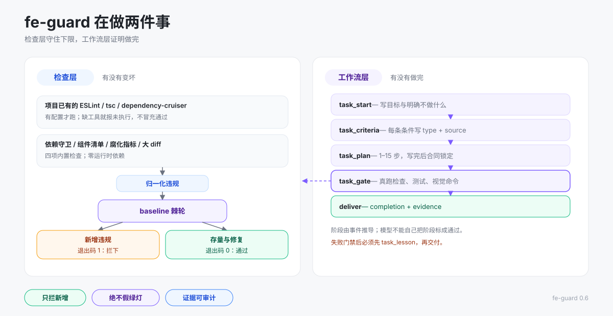
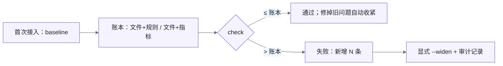
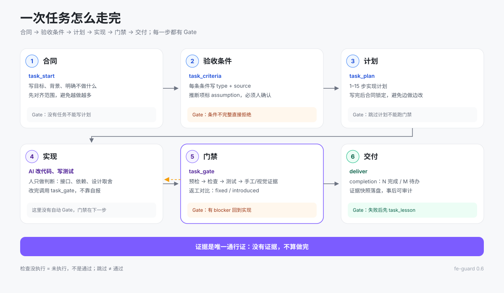
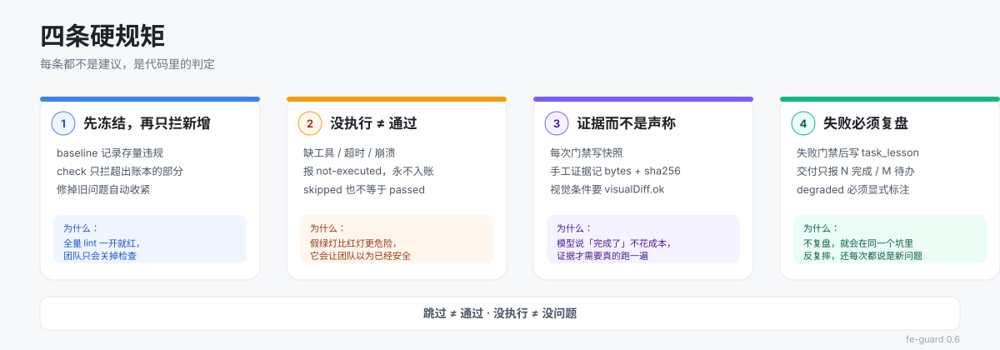
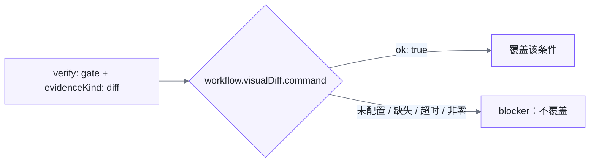
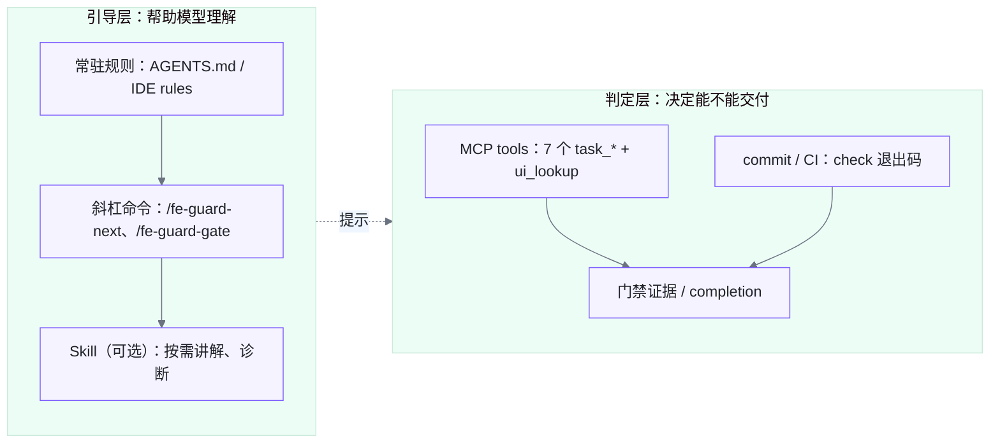
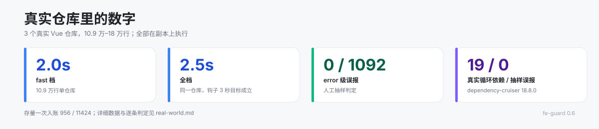

# 从「不更坏」开始：fe-guard 的前端质量门禁与 AI 工作流

> 用 baseline 棘轮冻结历史欠债，把 AI 的「已完成」变成可核对的门禁证据。

**本文目录**

- [01 · 先说结论](#01--先说结论)
- [02 · 一个熟悉的下午](#02--一个熟悉的下午)
- [03 · 为什么全量 lint 救不了](#03--为什么全量-lint-救不了)
- [04 · 两层：检查与工作流](#04--两层检查与工作流)
- [05 · baseline：先冻结，再只拦新增](#05--baseline先冻结再只拦新增)
- [06 · 工作流：把「做完了」拆成证据](#06--工作流把做完了拆成证据)
- [07 · 0.6：视觉证据只认项目自己的命令](#07--06视觉证据只认项目自己的命令)
- [08 · Skills、规则与 MCP：各管什么](#08--skills规则与-mcp各管什么)
- [09 · 真实仓库的数字](#09--真实仓库的数字)
- [10 · 适合谁，不适合谁](#10--适合谁不适合谁)
- [11 · 五分钟接入](#11--五分钟接入)
- [12 · 最后](#12--最后)

---

## 01 · 先说结论

fe-guard 只做一件事：让「不准更差」自动执行。

- **把已有的 lint / tsc / dependency-cruiser 变成一条只拦新增的门禁。** 历史欠债冻结进 baseline，修掉后账本自动收紧。
- **把 AI 的「完成了」变成可核对的门禁证据。** MCP 工具推进「合同 → 验收条件 → 计划 → 实现 → 验证 → 交付」，模型不能自己把阶段标成通过。
- **绝不假绿灯。** 没执行的检查记为 `not-executed`，永远不能进 baseline；跳过不等于通过。



*图 1：检查层回答「有没有变坏」，工作流层回答「有没有做完」。*

| 它能做什么 | 它不能做什么 |
| --- | --- |
| 编排项目已有的 ESLint / tsc / dependency-cruiser | 不替代 ESLint / tsc，不重新实现检查器 |
| baseline 冻结存量，只拦新增 | 不自动修复，不替你重构 |
| monorepo 按 package 各记一本账 | 不做语义级「这个组件该不该复用」判断 |
| MCP 流程 + 门禁证据 + 完成度报告 | 不内置浏览器，也不做像素对比 |
| JSON / SARIF / 单文件 HTML 报告 | 不提供跨仓库任务队列或分布式执行 |

---

## 02 · 一个熟悉的下午

上午十点，你把需求单和设计稿丢给 AI：

> 「实现一下，做完告诉我。」

三分钟后，它回复：

> 「已完成全部功能开发，所有功能均已实现并通过验证。」

语气笃定，格式漂亮。你打开页面：

- 按钮应该有 hover 态，但它一直显示着；
- 弹窗标题和选项之间多空了一截；
- 移动端长按菜单没做；
- 刷新一下，刚才插进去的内容没了。

你开始写 bug 描述；它说「您说得对，我来修复」；改完你再看，又发现新问题。到下班，你写了二十多条 bug 描述，一行代码没写。

这不是 AI 不会写代码，而是「已完成」这三个字太便宜。fe-guard 不试图让模型更聪明，它做的是让「完成」需要证据。

---

## 03 · 为什么全量 lint 救不了

大多数前端仓库不是被一次大重构拖垮的，而是被一连串看起来「还好」的提交磨坏的。

一次需求多写了一个下拉框，和已有组件只差两个 props；为了赶进度引入第二套日期库；一个页面从 300 行长到 800 行；`any` 从 3 个变成 30 个。单独看每个 diff 都能通过评审——它确实解决了眼前的问题。三个月后，重复组件、两套时间处理、没人敢动的巨石文件一起出现，团队才开始讨论「要不要治理」。

传统做法是全量 lint：第一次打开就是几百上千条，评审说「先关掉，等有空再清」。检查从此不再是门禁，只是一份没人看的报告。AI 加入后，生成速度更快，这个问题只会更早出现——写得越快，越需要一条自动守住下限的路径。

### 不是又一个 lint 包装器

fe-guard 不重新实现 ESLint，也不要求团队换工具。它做的是编排和归一化：把不同工具的输出变成同一种违规结构，再叠加三件工具本身不提供的能力：

- **存量棘轮**：只拦新增，历史可审计；
- **统一执行**：monorepo 按包、Vue 自动 `vue-tsc`、子目录根、fast / full 两档；
- **报告出口**：JSON / SARIF / 单文件 HTML，接 CI 与代码扫描。

### 七项检查：把确定性的问题交给工具

| 检查 | 拦什么 |
| --- | --- |
| ESLint / TypeScript / 架构边界 | 语法、类型、循环依赖与跨层引用 |
| 依赖守卫 | 未登记的新依赖、幽灵包、同类能力用了两个库 |
| 组件清单 | 同名组件、props 高度重合的重复实现 |
| 腐化指标 | 文件行数、长函数、显式 `any`、跨文件重复块 |
| 大 diff | 一次改太多文件/行，要求拆 PR |

baseline 记两本账：`(文件, 规则) -> 允许条数` 和 `(文件, 指标) -> 允许最大值`。只紧不松，`firstSeen` / `widenLog` 可审计。monorepo 还可以按 package 各记一本账，A 包还债不会误收紧 B 包。

### monorepo、Vue 与 React

- **monorepo**：识别 `package.json` workspaces、`pnpm-workspace.yaml`、`lerna.json`；ESLint / TypeScript 按 package 各用自己的配置并行执行；0.5 起 baseline 也可以按 package 记账。
- **Vue**：检测到 `.vue` 自动切 `vue-tsc`；有 `.vue` 但 vue-tsc 不可用时明确失败，不会静默跳过。
- **React / TSX**：已在真实开源仓库验证；stories 与测试文件不再被当成组件。
- **子目录项目**：前后端同仓时，用 `--root frontend` 挂载，git 相关路径语义正确。

零运行时依赖，Node 18+，安装体积就是几份源码。

---

## 04 · 两层：检查与工作流

fe-guard 不假设项目能一次还清历史欠债。它把质量拆成两层：**检查层**负责「有没有变坏」，**工作流层**负责「有没有做完」。两层可以一起用，也可以只用检查层。

过去这些事情主要靠人：

| 以前人做 | 现在 fe-guard 接管 | 人还需要做什么 |
| --- | --- | --- |
| 通读需求、找漏项 | 强制每条条件写 `type` + `source`；推断项标 `assumption` | 确认推断项（`task confirm`） |
| 逐个点页面验收 | 门禁真跑 ESLint / tsc / 测试 / 视觉命令，证据落盘 | 提供视觉命令，判断业务取舍 |
| 发现问题后告诉 AI 怎么改 | blockers 指向新增违规、未覆盖条件、未确认推断 | 决定是否 `--widen` / `task defer` |
| 判断到底做完没有 | `completion` + evidence；只报「N 完成 / M 待办」 | 做最终发布决定 |
| 提醒别犯上次的错 | baseline 棘轮防回归 + `task_lesson` | 写复盘、确认教训 |

这不是「让 AI 自己说做完了」，而是把「做完」拆成可以核对的事实。

---

## 05 · baseline：先冻结，再只拦新增

检查层的第一条规则是 baseline 棘轮：

- 第一次接入跑一次 `baseline`，把现有违规记进账本；
- 之后每次 `check` 只拦「超出账本」的新增；
- 修掉旧问题，账本自动收紧；要放宽必须显式 `--widen` 并留下审计；
- monorepo 可以按 package 各记一本账，A 包还债不会误收紧 B 包。



这和「全量必须干净」的思路相反：**它承认历史，但不允许历史继续变多。** 项目不一定因为一次治理突然变好，但可以因为每次提交都没有变坏而慢慢变好。

如果账本被误删，`baseline --verify` 会判失败，而不是静默解冻欠债。

---

## 06 · 工作流：把「做完了」拆成证据

检查层回答「有没有变坏」，工作流层回答「到底做完了没有」。fe-guard 通过 MCP 把流程做成工具：

**合同 → 验收条件 → 计划 → 实现 → 门禁 → 交付**



*图 2：六张卡片对应六个阶段；每个阶段都有 Gate，门禁失败回到实现。*

| 阶段 | 工具 | 产物 |
| --- | --- | --- |
| 合同 | `task_start` | 目标、背景、明确不做什么 |
| 验收条件 | `task_criteria` | `type` + `source`；可挂 `testFile` / `evidenceFile` |
| 计划 | `task_plan` | 1–15 步；写完后合同锁定 |
| 实现 | —— | 代码、测试、必要的证据文件 |
| 门禁 | `task_gate` | 检查、测试、手工/视觉证据、返工对比 |
| 交付 | 事件推导 | `completion` + 证据快照 |

模型不能自己把阶段标成通过，也没有「我完成了」这个工具。每个动作都写入事件流，阶段由事件推导：

- **验收条件**必须写 `type`（UI / 交互 / 数据 / 埋点 / 兼容 / 性能）和 `source`（需求、设计稿、代码或 `assumption`）；
- 能写成测试的挂 `testFile`，门禁真跑测试；手工/视觉验证必须挂 `evidenceFile`，记录 `bytes` 与 `sha256`；
- 推断项要人执行 `task confirm`；明确放弃的条件要人执行 `task defer`，交付会标 `degraded`，并列出待办；
- 每次门禁写快照 `.fe-guard/evidence/...`，报告本轮修好几条、又引入几条；
- 失败过的门禁，交付前要写 `task_lesson`；`workflow.distill` 默认 `enforce`；
- `task stats` 只读聚合交付率、门禁失败率、top blocker、复盘与待办。

这些不是提示词建议，而是代码里的判定。模型可以说「我完成了」，但只有门禁证据能让任务进入交付态。

### 四条硬规矩



*图 3：每条规矩都配一句「为什么」，不是形式主义。*

- **先冻结，再只拦新增**：baseline 记录存量，`check` 只拦超出账本的部分。
- **没执行 ≠ 通过**：缺工具、超时、崩溃都记 `not-executed`，永不入账。
- **证据而不是声称**：门禁快照、手工证据 sha256、视觉条件 `visualDiff.ok`。
- **失败必须复盘**：`task_lesson`；交付只报「N 完成 / M 待办」。

### 诚实工程：不假绿灯

- 缺工具、超时、子进程崩溃 → `<check>/not-executed`，永远不能进 baseline；
- 没有 ESLint 配置的 package → 记录为 `skipped`，不是通过；
- Vue 项目里 depcruise 只解析了部分 `.vue` → 报「依赖图不完整」，不给假 0；
- 环境预检失败 → 本次检查未执行，不覆盖条件；多步预检任一步失败，错误会指出具体步骤；
- 删掉 package 账本 → `baseline --verify` 判失败，而不是静默解冻欠债。

跳过不等于通过，没执行不等于没问题。这是它和「跑个 lint 就算质量门禁」最大的区别。

---

## 07 · 0.6：视觉证据只认项目自己的命令

0.6.0 把「截图 / 对比」从口号变成了可选的门禁证据，但不把浏览器塞进工具：

- 验收条件可声明 `evidenceKind`：`screenshot` / `diff` / `log`；manual 缺省按扩展名推断，`verify: gate` 只接受 `diff`。
- 配 `workflow.visualDiff.command` 后，只要本轮有视觉条件，门禁就执行一次项目自己的命令；所有视觉条件共用这一次结果。
- 命令的 stdout / stderr 落盘到 `.fe-guard/evidence/<taskId>/<evidenceId>-visual.log`，记录退出码、字节数与 sha256。
- 只有 `visualDiff.ok === true` 才算覆盖；未配置、命令缺失、超时、非零退出都不算，`warn` 模式也不放宽。
- 不启动浏览器、不安装依赖；Playwright / Chromatic / 自研脚本都由项目提供。



```json
{ "workflow": { "visualDiff": { "command": "npm run visual:diff", "timeoutMs": 120000 } } }
```

预检也支持多步：`workflow.preflight.steps[]` 写 1–10 个命名检查，顺序执行、失败即停；失败信息会指出具体步骤。它和单命令 `command` 二选一。细节见 [workflow](workflow.md) 与 [configuration](configuration.md)。

Agent 自己截的图可以作为 `verify: manual` + `evidenceKind: "screenshot"` 的人工证据，但不能替代 `verify: gate` + `diff`；后者必须由 `visualDiff.command` 跑出结果。

---

## 08 · Skills、规则与 MCP：各管什么

fe-guard 不要求安装任何 Skill。`init` 生成的是常驻规则、斜杠命令和 MCP 配置；Skill 是可选的说明书，不是判定层。



| 层 | 产物 / 位置 | 职责 | 能否替代门禁 |
| --- | --- | --- | --- |
| 常驻规则 | `AGENTS.md` 受管片段；`.trae/rules/fe-guard.md`；`.cursor/rules/fe-guard.mdc` | 用最少 token 告诉模型必须走哪些工具 | 不能；模型可以无视 |
| 斜杠命令 | `.trae/commands/fe-guard-next.md`、`fe-guard-gate.md` | 手动触发下一步 / 门禁 | 不能；只是入口 |
| Skill（可选） | 项目或全局 skill；fe-guard 目前不内置 | 按需讲解、诊断、批量操作 | 不能；只做引导 |
| MCP tools | 7 个 `task_*` + `ui_lookup` | 推进阶段、真跑检查、写证据 | 流程内硬判定 |
| commit / CI | `check --staged --profile fast`、`check --full` | 流程外兜底 | 唯一不可绕过（除 `--no-verify`） |

为什么不在 Skill 里做判定：

- **Token**：常驻规则有成本，AGENTS.md 片段控制在约 591 / 600 token；Skill 按需加载，但仍只是说明。
- **可验证性**：阶段与条件覆盖由事件和证据推导；Skill 写得再好，也不能让 `task_gate` 通过。
- **单一事实源**：生成物统一来自 `src/ide/source.js`；再写一份 Skill 规则，等于维护第二套流程。
- **适合 Skill 的事**：长尾诊断（doctor、FAQ 排查、批量操作），而不是核心流程判定。

> **一句话**：不安装 Skill 也能用。MCP 是硬路径，Skill 只是可选的按需引导。

---

## 09 · 真实仓库的数字



*图 4：3 个真实 Vue 仓库副本上的实测结果。*

- 10.9 万行单仓库：`--profile fast` **2.0s**，全档 **2.5s**，钩子 3 秒目标成立；
- 存量一次入账 956 / 11424 条，随后 `check` 退出码 0，默认只逐条展示新增；
- error 级误报 **0 / 1092**；
- boundaries（depcruise 18.8.0）抓到 **19 条真实循环依赖**，抽样 3 条人工追链，**0 误报**，耗时 <1s。

React / TSX 也在两个开源仓库上跑过，并修掉了真实问题：Storybook stories 被当成组件、子目录项目比对错 `package.json`、整包被 ESLint 忽略导致门禁中断、`pnpm-workspace.yaml` 的 `"."` 让根包跑两遍。

这些数字不代表 fe-guard 能替你做架构评审；它只说明：**确定性的问题，可以交给确定性的工具。** 完整数据与逐条判定见[实测报告](real-world.md)。

---

## 10 · 适合谁，不适合谁

| 适合 | 不适合 |
| --- | --- |
| 有历史欠债、又不想因为一次全量 lint 把检查关掉的前端仓库 | 只改一行文案、不需要任何流程的小改动 |
| 多人 / 多包 / AI 参与开发，靠人审已经拦不住重复组件、依赖膨胀和文件腐化 | 希望工具替你做语义级架构判断、自动重构、自动修所有问题 |
| 想让 AI 的「已完成」有证据，而不是靠人一个个点页面 | 不愿意把 baseline 变更纳入评审的团队——账本需要人负责 |

### 四个常见误解

**这是不是又一个 lint 包装器？**
不是。lint 只回答「当前这一行有没有问题」；fe-guard 还回答「这次提交有没有比账本更差」，以及「AI 说的做完了有没有证据」。

**baseline 是不是永久豁免？**
不是。账本只紧不松：修掉旧问题会自动收紧；要放宽必须显式 `--widen` 并留下审计；删掉 package 账本会被 `--verify` 拦住。

**AI 截图能替代视觉证据吗？**
不能。截图可以作为 `verify: manual` 的人工证据；声明为 `verify: gate` + `diff` 的条件必须由项目自己的 `visualDiff.command` 跑出结果。

**一定要用 MCP 吗？**
不一定。`check` / `baseline` 可以独立使用；MCP 流程层是给「AI 参与开发、需要可核对交付」的场景加的。

---

## 11 · 五分钟接入

```bash
npm i -D github:luffy-lcc/fe-guard#v0.6.0   # 或使用 Release 里的 tgz
npx fe-guard init      # 探测项目，生成配置、账本、AGENTS.md 与 MCP 配置
npx fe-guard baseline  # 把现有存量记入账本
npx fe-guard check     # 只拦新增
```

第一次跑完 `baseline` 后，`check` 应该退出码 0；之后默认只逐条展示新增。钩子和合并前各一条：

```bash
npx fe-guard check --staged --profile fast   # pre-commit，3 秒内
npx fe-guard check --full                    # 合并前，全档
```

报告可以直接输出 JSON、SARIF 或单文件 HTML：

```bash
npx fe-guard check --full --format sarif > fe-guard.sarif
npx fe-guard check --full --format html
```

更多命令、`doctor`、内网分发与排错见[快速上手](getting-started.md)。

---

## 12 · 最后

AI 写代码的速度已经不是瓶颈，瓶颈是「写完之后谁来验收」。fe-guard 的答案很朴素：

> 不信它说的，只信它拿出来的证据；不让项目因为一次「已完成」变得更坏。

如果这个思路对你有用，可以从一个仓库、一个 `baseline`、一条 pre-commit 开始。它不会让项目一夜之间变干净，但会让下一次提交没有变得更糟。
