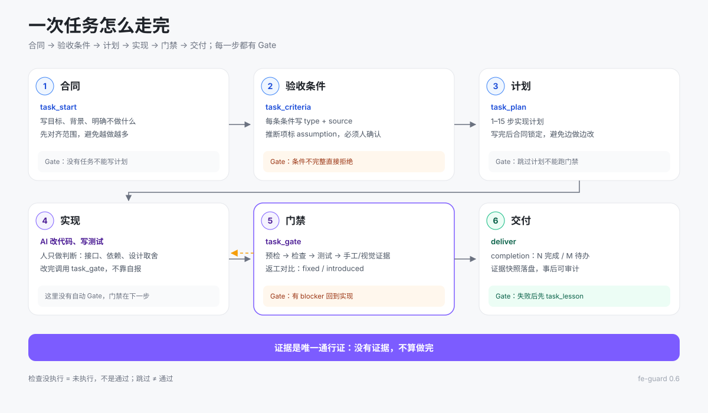
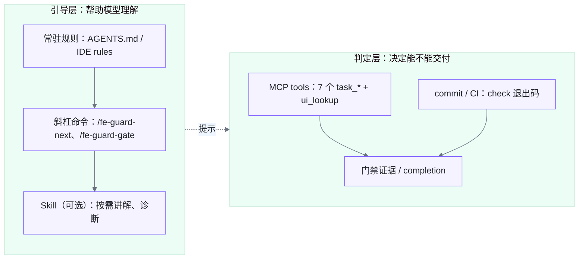
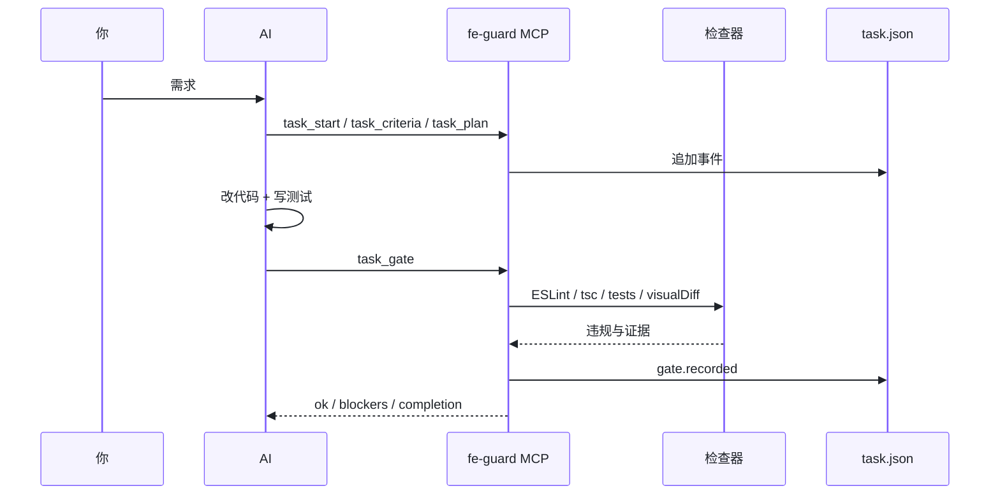
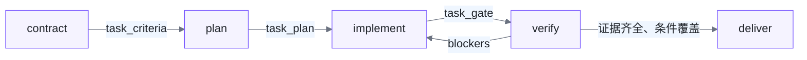

# 在 AI IDE 里用对话驱动开发

[← 返回 README](../../README.zh-CN.md) · [English](../workflow.md)

## 为什么不写一大段提示词

给 AI 写一段「请先写需求、再写计划、最后跑检查」的规则，基本靠不住：规则文件整体并不提升成功率，反而增加约 20% 推理成本。真正有效的只有一类——**模型靠常识猜不到的非标准约定**。

所以流程层的做法是：

- 流程做成**工具**（MCP server）。AI 必须调用工具才能推进，阶段由工具写下的事件推导。
- 硬规则写在**代码**里。没有「把阶段标记为通过」的工具，模型输出什么都无法让任务进入交付态。
- 生成出来的规则文件只留最短的那部分非标准约定（AGENTS.md 片段约 591 token，上限 600）。



*图：合同 → 验收条件 → 计划 → 实现 → 门禁 → 交付；每一步都有 Gate。*

## Skills、规则与 MCP：各管什么

fe-guard 不要求安装任何 Skill。`init` 生成的是常驻规则、斜杠命令和 MCP 配置；Skill 是可选的说明书，不是判定层。



| 层 | `init` 产物 / 位置 | 职责 | 能否替代门禁 |
| --- | --- | --- | --- |
| 常驻规则 | `AGENTS.md` 受管片段；`.trae/rules/fe-guard.md`；`.cursor/rules/fe-guard.mdc` | 用最少 token 告诉模型必须走哪些工具 | 不能；模型可以无视 |
| 斜杠命令 | `.trae/commands/fe-guard-next.md`、`fe-guard-gate.md` | 手动触发下一步 / 门禁 | 不能；只是入口 |
| Skill（可选） | 项目或全局 skill；fe-guard 目前不内置 | 按需讲解、诊断、批量操作 | 不能；只做引导 |
| MCP tools | 7 个 `task_*` + `ui_lookup`，共 8 个 | 推进阶段、真跑检查、写证据 | 流程内硬判定 |
| commit / CI | `check --staged --profile fast`、`check --full` | 流程外兜底 | 唯一不可绕过（除 `--no-verify`） |

为什么判定不放在 Skill 里：

- **Token**：常驻规则有成本，AGENTS.md 片段约 591 / 600 token；Skill 按需加载，但仍只是说明。
- **可验证性**：阶段与条件覆盖由事件和证据推导；Skill 写得再好，也不能让 `task_gate` 通过。
- **单一事实源**：生成物统一来自 `src/ide/source.js`；再写一份 Skill 规则，等于维护第二套流程。
- **适合 Skill 的事**：长尾诊断（doctor、FAQ 排查、批量操作），而不是核心流程判定。

## 挂到 Trae

1. 在项目里执行 `npx fe-guard init`（已写入 `.trae/mcp.json`）。
2. 打开 Trae 的 MCP 面板，确认出现 `fe-guard`，能看到 7 个 `task_*` 工具和 1 个 `ui_lookup`。
3. `.trae/rules/fe-guard.md` 作为项目规则被读取；`.trae/commands/` 下多了两个斜杠命令 `/fe-guard-next`、`/fe-guard-gate`。

生成的配置大致是：

```json
{
  "mcpServers": {
    "fe-guard": {
      "command": "node",
      "args": ["./node_modules/fe-guard/bin/fe-guard-mcp.js"]
    }
  }
}
```

如果项目里没有本地安装 fe-guard（比如直接用本仓库的 CLI），这里会写成当前这份安装的绝对路径；换机器后重跑一次 `init` 即可。

> macOS GUI 应用不加载 shell 的 PATH：node 装在 nvm / fnm 下时，`command: "node"` 可能 ENOENT，面板红错、0 个工具。把 `command` 与 `args` 全改成绝对路径即可。详见 [FAQ](faq.md)。

## 挂到 Cursor

1. `npx fe-guard init` 已写入 `.cursor/mcp.json`，在 Settings → MCP 里确认 `fe-guard` 已启用。
2. `.cursor/rules/fe-guard.mdc` 已设 `alwaysApply: true`，Cursor 会自动读取。

## 挂到 Claude Code / VS Code / Gemini CLI

`init` 还会写这几个客户端的项目级配置，只合并自己的 `fe-guard` 条目：

| 客户端 | 文件 | 结构 |
| --- | --- | --- |
| Claude Code | `.mcp.json` | `mcpServers.fe-guard` |
| VS Code（Copilot agent） | `.vscode/mcp.json` | `servers.fe-guard`，带 `"type": "stdio"` |
| Gemini CLI | `.gemini/settings.json` | `mcpServers.fe-guard`；文件里的其它设置不动 |

重载客户端或重新打开项目即可加载。Windsurf / Cline / Codex CLI 刻意不写：它们只接受用户级配置，而 fe-guard 不碰用户 home。

所有客户端用同一个 server、同一份 `AGENTS.md`、同一份任务状态，换工具不用重配。

## 装完之后，对话是什么样

你说：「给项目加一个 formatDuration 工具函数，1 秒显示 1s」。

AI 会依次调用下面的工具（IDE 的工具面板里能看到每个请求和返回值）：

| 步骤 | 工具 | 返回 |
| --- | --- | --- |
| 1 | `task_start` | `{ ok, taskId, stage: "contract", next: "task_criteria" }` |
| 2 | `task_criteria` | `{ ids: ["C1","C2"], stage: "plan", types: { ui: 1, data: 1 } }` |
| 3 | `task_plan` | `{ stage: "implement", next: "task_gate" }` |
| 4 | 改代码 | —— |
| 5 | `task_gate` | 通过：`{ ok: true, stage: "deliver", completion: { achieved: 2, total: 2, remaining: [], deferred: [] } }` |

整条链路：



能写成测试的条件可以挂 `testFile`（仓库内相对路径，如 `{ text: "formatDuration(1000) 返回 1s", type: "data", source: "需求#时长", testFile: "test/duration.test.mjs" }`）。门禁会真跑这个测试，**通过才覆盖该条件**；测试命令来自配置 `workflow.gate.testCommand`（默认 `node --test`），模型只能给路径、不能给命令。每条条件还必须写 `type` 与 `source`，其余字段见下文。

门禁没过时，第 5 步返回的是：

```json
{
  "ok": false,
  "stage": "verify",
  "completion": { "achieved": 0, "total": 2, "remaining": [{ "id": "C1", "text": "..." }], "deferred": [] },
  "blockers": [
    "门禁未通过：新增 1 条违规（error 1）",
    "eslint/@typescript-eslint/no-explicit-any @ src/utils/math.ts:12",
    "验收条件未覆盖：C1"
  ],
  "next": "修复问题后再次调用 task_gate"
}
```

AI 按 blockers 去修，再调一次 `task_gate`。工具不会回传整份日志（避免把几万行塞回上下文），需要细节时它自己去读 `.fe-guard/report.json`。

## 验收条件：类型、出处、验收方式

每条条件都是结构化的，只传 `{ text }` 会被拒绝：

| 字段 | 必填 | 说明 |
| --- | --- | --- |
| `type` | 是 | `ui` / `interaction` / `data` / `tracking` / `compat` / `performance` |
| `source` | 是 | 出处：需求、设计稿、代码或既有行为；无法确认时写 `assumption: 原因` |
| `verify` | 否 | `gate` / `test` / `manual`；缺省按 testFile→test、evidenceFile→manual、否则 gate |
| `testFile` | 否 | 仓库内测试文件相对路径；门禁真跑，通过才覆盖该条件 |
| `evidenceFile` | 否 | 仓库内手工证据相对路径（截图说明、对账记录）；门禁校验存在且非空 |
| `evidenceKind` | 否 | `screenshot` / `diff` / `log`；manual 缺省按扩展名推断，gate 只接受 `diff`（要求配置 `workflow.visualDiff.command`） |

```json
{
  "criteria": [
    { "text": "空态显示 0 条", "type": "ui", "source": "设计稿/spec-v3#empty", "verify": "gate" },
    { "text": "formatDuration(1000) 返回 1s", "type": "data", "source": "需求#时长", "testFile": "test/duration.test.mjs" },
    { "text": "键盘焦点按 tab 顺序移动", "type": "interaction", "source": "assumption: 设计稿没有键盘态", "verify": "manual", "evidenceFile": "docs/evidence/focus.md" }
  ]
}
```

`testFile` 与 `evidenceFile` 互斥，`verify` 必须与它们一致（test → testFile、manual → evidenceFile、gate → 两者都不传）。全部条件都是 `ui` 时 `task_criteria` 返回 warning：不阻断，但通常说明漏了数据、交互、埋点、兼容或性能类条件。

## 人工决策：确认与待办

有两个决定刻意只提供 CLI——MCP 没有对应工具，模型无法自己批准：

```bash
# 确认 assumption 条件（必须记在条件创建之后）
npx fe-guard task confirm C2 --note "问过产品：空态应该隐藏列表" --yes

# 把条件明确转成上线待办
npx fe-guard task defer C3 --reason "后端接口还没联调" --yes
```

- `confirm` 只接受 `source` 以 `assumption` 开头的条件；早于条件创建的确认不算。
- `defer` 表示「明确放弃或之后上线」。被 defer 的条件不要求证据，但交付会标 `degraded`，完成度里单独列出。
- 两条命令都不能把任务标成交付；阶段仍由事件推导。

3 条条件里 2 条有证据、1 条 deferred 时，返回的是「2 完成 / 1 待办」，不会出现「全部完成」。`task status`、`task events --summary` 用的是同一套口径。

## 证据：快照与手工证据

每次门禁写 `.fe-guard/evidence/<taskId>/<evidenceId>.json`，包含模式、退出码、汇总、完成度、条件测试、手工证据、违规指纹与预检结果。`task_gate` 返回 `evidencePath`；`task_status` 返回 `lastEvidencePath` 以及每条证据的路径。写入失败时门禁结论不变，但路径为 `null`。

`verify: manual` 的条件记录 `{ file, bytes, sha256, kind }`，即门禁当时文件内容的指纹（事后可用同一 hash 核对是否被替换）。`kind` 为 `screenshot` / `diff` / `log`，未显式声明时按扩展名推断（图片 → screenshot，`.diff/.patch` → diff，其余 → log）。这只证明文件存在且内容未被替换，**不证明**截图或记录内容正确；视觉判断仍需人或外部工具。

`verify: gate` + `evidenceKind: "diff"` 的条件由视觉对比命令覆盖：只有 `visualDiff.ok === true` 才算完成，命令失败、缺失或超时都不会覆盖，即使 `workflow.stages.verify` 是 `warn`。

`completion` 是 `{ achieved, total, remaining, deferred }`。汇报用「N 完成 / M 待办」；只要 `remaining` 或 `deferred` 非空，就不能说全部完成。

## 环境预检

单命令写法（兼容旧配置）：

```json
{ "workflow": { "preflight": { "command": "npm run check:env", "timeoutMs": 60000 } } }
```

多步写法：

```json
{
  "workflow": {
    "preflight": {
      "timeoutMs": 60000,
      "steps": [
        { "name": "dev-server", "command": "curl -fsS http://127.0.0.1:5173", "timeoutMs": 5000 },
        { "name": "api-proxy", "command": "curl -fsS http://127.0.0.1:5173/api/health" }
      ]
    }
  }
}
```

`command` 与 `steps` 二选一；`steps` 1–10 步、`name` 不重复，每步可单独设 `timeoutMs`（缺省用顶层值）。多步按顺序执行，失败即停，错误会指出具体步骤。未配置（`command` 为空且没有 `steps`）即关闭。

配置后：

- `task_start` 先执行；失败返回 `ok:false`，带失败步骤、命令、退出码与输出尾部，且**不会创建任务**。
- `task_gate` 再执行；失败会追加 `preflight.failed`，返回「环境预检未通过，本次检查未执行」：不写证据、不覆盖条件。

命令按空白拆分（不做 shell 解释），与 `workflow.gate.testCommand` 一致。fe-guard 只执行项目自己提供的命令，不知道 dev server、代理或登录态。

## 视觉对比：只执行项目自己的命令

```json
{ "workflow": { "visualDiff": { "command": "npm run visual:diff", "timeoutMs": 120000 } } }
```

- 只有存在 `verify: gate` + `evidenceKind: diff` 的条件时才执行；同一次门禁只跑一次，结果覆盖所有视觉条件。
- 检查本身未通过时不执行，避免无意义的外部命令。
- stdout + stderr 落盘到 `.fe-guard/evidence/<taskId>/<evidenceId>-visual.log`，记录退出码、字节数和 sha256。
- 命令非零、缺失、超时或证据写入失败 → 条件未覆盖，并给出 blocker；绝不判通过。
- 不启动浏览器、不做像素对比、不安装依赖；Playwright / Chromatic / 自研脚本都由项目提供。
- 没有视觉条件时不执行，并在证据里记录 `ran: false, reason: "no-visual-criteria"`。

配图与取舍说明见[推广页](promotion.md)的「0.6：视觉证据只认项目自己的命令」。

## 返工对比：修好与改坏

门禁证据保存违规指纹（规则 + 文件 + 行，上限 100）。每次门禁与上一轮对比并返回：

```json
{ "trend": { "previousNew": 3, "fixed": 2, "introduced": 1 } }
```

上一轮已经失败、这一轮仍引入新违规时，会额外给出回归提示（「先确认是否在修一个问题的同时引入了新问题」）。boundaries 没有行号，这类指纹按文件 + 规则比较，挪动代码可能被看成修好或回归。

## 复盘：task_lesson 与 distill

`task_lesson` 在失败门禁之后记录结论：

```json
{ "text": "偶发失败是定时器，不是新代码", "evidence": ".fe-guard/evidence/T-.../E2.json", "scope": "none", "scopeReason": "一次性问题，没有要改的规则" }
```

- `scope` 是 `skill` / `rule` / `none`；`none` 必须写 `scopeReason`。
- 记录追加到 `.fe-guard/lessons.jsonl`；事件流仍是唯一权威来源。
- `workflow.distill` 控制强制程度：`enforce`（默认）要求最近一次失败门禁之后必须有复盘才能交付；`warn` 允许交付但标记 `degraded`；`off` 关闭要求。

## 效果统计：task stats

```bash
npx fe-guard task stats
npx fe-guard task stats --json
```

只读聚合当前任务与 `.fe-guard/tasks/` 归档：任务数、交付/降级/进行中、门禁次数与失败率、平均门禁次数、按规则排序的 top blocker、复盘与待办数量。损坏的归档文件会跳过并计数，不写任何状态。

## AI 在什么情况下会被拦住

| 它想干什么 | 实际发生 |
| --- | --- |
| 不写合同直接改代码 | 没有任务时 `task_plan` / `task_gate` 报错，提示先 `task_start` |
| 不写验收条件就写计划 | `task_plan` 报错：必须先写条件 |
| 条件不写 `type` / `source` | `task_criteria` 拒绝调用，并指出缺哪些字段 |
| 自己宣布「已达成」 | 没有这个工具；`task_criteria` 只收 `id` / `text` / `type` / `source` / `verify` / `testFile` / `evidenceFile` / `evidenceKind`，传 `achieved` 被拒 |
| 挂了 testFile 却不写测试 / 测试失败 | 门禁真跑测试：文件缺失、失败、超时都拦住，结果写进证据 |
| 声明手工条件但证据文件缺失或为空 | 门禁报 blocker，该条件不被覆盖 |
| 声明视觉条件但视觉命令没跑 / 失败 | 门禁不覆盖该条件；缺失、超时、非零退出都列为 blocker |
| 推断项不确认就想交付 | 门禁拦住并给出确切的 `task confirm` 命令 |
| 想通过 MCP 执行 `confirm` / `defer` | 没有这两个工具——必须由人跑 CLI |
| defer 之后宣称「全部完成」 | 完成度返回「N 完成 / M 待办」，响应里不会出现「全部完成」 |
| 自己宣布「阶段通过」 | 没有这个工具；`task_status` 也不接受 `status` 参数 |
| 门禁没过就想交付 | 停在 `verify`，不产生交付事件，条件达成数仍是 0 |
| 失败门禁后不复盘就交付（distill `enforce`） | 被拦住，blocker 指向 `task_lesson` |
| 环境预检失败时开始任务 | `task_start` 返回 `ok:false`，不创建任务 |
| 把预检失败的门禁当成通过 | 门禁明确「本次检查未执行」：不产证据、条件不被覆盖 |
| 重复写计划 / 重复开任务 | 被拒绝；未交付的任务不能再次 `task_start` |
| 改 baseline 让门禁变绿 | `task_gate` 只会收紧 baseline；放宽必须手动 `fe-guard baseline --widen` |

被拒绝的调用会记进事件流（`tool.rejected`），`npx fe-guard task events` 能看到 AI 当时试了什么。

## 阶段是怎么定出来的

没有「设置阶段」的接口。`task.json` 里只有事件，阶段由事件推导：

```
没有任务             → none
有 task.started      → contract
+ criteria.declared  → plan
+ plan.written       → implement
+ gate.recorded      → verify
+ task.delivered     → deliver
```



一次门禁就通过时，`implement` 会直接跳到 `deliver`，中间不出现「实现完成」这个要模型判断的状态——「实现完了没有」本来就只能由门禁回答。这也是为什么阶段是 5 个而不是更多。

## token 开销大概什么量级

| 项目 | 量级 |
| --- | --- |
| `AGENTS.md` 受管片段（常驻） | 约 591 token，上限 600，`init` 会校验 |
| 单次工具返回 | 200–600 字节 JSON（最长的是门禁，含 blockers）；`ui_lookup` 通常不到 300 字节 |
| `tools/list`（IDE 启动时拉一次） | 约 2.9 KB（8 个工具） |

作为对照：同样流程写成自然语言规则通常要 800–1500 token 常驻，而且不可执行。这里把常驻成本压到 591 token，判断逻辑放进工具。

## 开关

```json
{
  "workflow": {
    "enabled": true,
    "gate": { "mode": "full", "testCommand": "node --test", "testTimeoutMs": 120000 },
    "stages": { "contract": "enforce", "plan": "enforce", "verify": "enforce" },
    "preflight": { "command": "", "timeoutMs": 60000 },
    "visualDiff": { "command": "", "timeoutMs": 120000 },
    "distill": "enforce"
  }
}
```

| 字段 | 说明 |
| --- | --- |
| `workflow.enabled` | `false` 时只保留 `task_gate`，退回纯检查模式，流程工具明确拒绝 |
| `workflow.gate.mode` | 门禁范围：`full` / `diff-only` / `staged` |
| `workflow.gate.testCommand` | 挂 testFile 条件的测试命令（默认 `node --test`，可改 `npx vitest run` 等）。人类配置，模型只给文件路径 |
| `workflow.gate.testTimeoutMs` | 单个条件测试的超时（默认 120000ms） |
| `workflow.stages.contract` | `enforce` 时条件只能在合同阶段写；`warn` 允许后补；`off` 不限 |
| `workflow.stages.plan` | `enforce` 时没有计划不能跑门禁 |
| `workflow.stages.verify` | `enforce` 时失败的门禁不能覆盖验收条件；`warn` 允许覆盖，但交付会标 `degraded` |
| `workflow.preflight.command` / `steps` / `timeoutMs` | 可选的环境预检（默认空 = 关闭）。`command` 与 `steps` 二选一；失败会让 `task_start` 不创建任务、`task_gate` 报「本次检查未执行」，绝不假通过 |
| `workflow.visualDiff.command` / `timeoutMs` | 可选的视觉对比命令（默认空 = 关闭）。只执行项目自己的命令，不内置浏览器；未执行/失败都不会覆盖 `evidenceKind: "diff"` 的条件 |
| `workflow.distill` | `enforce`（默认）/ `warn` / `off`：失败门禁后是否必须复盘 |

`implement` / `deliver` 没有独立开关：它们完全由事件推导，不是一个可以被放宽的判定点。

## hooks 示例

`init` 会生成 `.trae/hooks.example.json` 和 `.cursor/hooks.example.json`，内容是「工具调用后跑 `check --diff-only --profile fast`」「会话结束时跑 `check --staged --profile fast`」。它们**不会自动生效**，需要你把命令搬到 IDE 的 hooks 设置里，事件名以你所用版本为准。

两家 IDE 都没有 git pre-commit 事件，提交前拦截仍然走 Husky + `fe-guard check --staged --profile fast`。

下一步：[路线图](roadmap.md)——fe-guard 的方向与后续候选。
